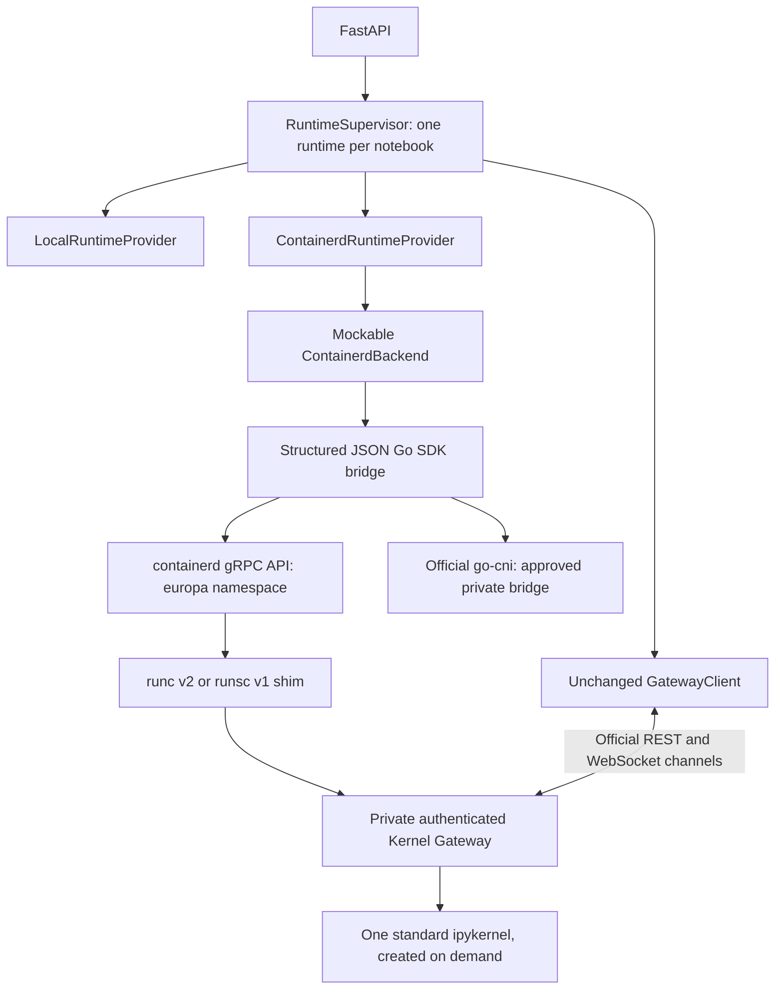

# Phase 2, Step 2B: containerd provider review

Implemented on `feature/containerd-provider`, based on Step 2A commit
`cd50ce8ebad6ddd674e24f46ccd4ce21c963ce57`. The final commit SHA is in the
completion response and Git history. Step 2B stops at the adapter, image definition,
unit validation, and opt-in integration suite. **Real containers were not run.**

## Environment and validation boundary

The host is Darwin arm64 (macOS 27.0.1), Python 3.13.0. No `containerd`, `ctr`,
`runc`, `runsc`, or Go executable was on PATH, and neither standard containerd
socket existed. VMware Fusion is installed, but no usable Linux VM was identified
in the inspected standard VM locations. A container launch could not be verified.
No privileged dependencies, services, or host networking were installed or changed.

A checksum-verified Go 1.24.6 Darwin arm64 toolchain and module/build caches were
placed in `/private/tmp` for compilation. This does not supply a Linux daemon,
runtime, CNI network, or isolation boundary. The adapter uses the user-authorized
mock-backed fallback. Its Linux SDK code compiles, but its runtime behavior remains
unverified until the real suite runs on suitable infrastructure.

## Architecture and containerd API strategy



Python invokes a small owned bridge executable using JSON on stdin/stdout, without
a shell. The bridge uses the supported containerd Go SDK/gRPC interfaces; `ctr`
output is never parsed. This follows containerd's recommendation to use its
[Go client](https://github.com/containerd/containerd/blob/v1.7.28/docs/getting-started.md).
Calls have deadlines; cancelled/timed-out bridge subprocesses are killed and reaped.
The backend protocol can be replaced without changing provider contracts or Gateway
communication. Sanitized backend errors do not echo tokens or upstream payloads.

The SDK owns image pull/unpack, overlayfs snapshots, container metadata/specs,
tasks, status, signal delivery, waits, and deletion. CNI uses the official
[go-cni library](https://github.com/containerd/go-cni), rather than an in-house
network stack. No OCI runtime, kernel process manager, or ZeroMQ transport is added.

Provision registers a UUID-derived runtime ID before any side effect. Container,
snapshot, CNI, and netns identities derive from it; metadata labels associate the
runtime and notebook. Readiness checks task liveness and authenticated
`/api/kernelspecs`. GatewayClient then creates kernels through REST and executes
through standard channels, retaining message correlation and both completion signals.
Kernel restart does not replace the container. Containers are separate per notebook;
the existing supervisor lock still deduplicates same-notebook provision requests.

Stop sends TERM, waits a bounded grace interval, then KILL if necessary. It removes
task/network resources while retaining container metadata and the snapshot for
explicit start. Destroy also removes the snapshot/container and temporary state.
Stop/destroy are idempotent. Partial failures retain ownership for retry; provider
`close()` also cleans allocations that failed before publishing a handle. Unexpected
task death yields FAILED status and removes its task/network. Start rotates the
Gateway token and increments generation; interpreter state and tmpfs contents are
lost on container task replacement. Notebook persistence is not implemented.

## Image, dependencies, and restrictions

Build context is the repository root, Dockerfile `runtime-image/Dockerfile`.
This is an OCI build definition; Docker is not required by the provider. Use an
approved OCI builder and import/publish the resulting image, then configure its
**actual resulting digest**. The Gateway image has not been built or pushed here.

| Component | Pin/configuration |
|---|---|
| Base | `python:3.13.0-slim-bookworm@sha256:0de818129b26ed8f46fd772f540c80e277b67a28229531a1ba0fdacfaed19bcb` |
| Gateway | 3.0.1, `kernel_gateway.jupyter_websocket` |
| ipykernel | 6.30.1, standard `python3` kernelspec |
| Jupyter Server library / client | 2.17.0 / 8.6.3; no second Server service |
| Python packages | Exact versions and hashes in `runtime-image/requirements.lock` |
| Go containerd SDK / API module | 1.7.28 / 1.8.0 |
| go-cni / OCI spec / typeurl / x/sys | 1.1.12 / 1.2.1 / 2.1.1 / 0.34.0 |
| Toolchain used | Go 1.24.6; complete transitive module checksums in `go.sum` |
| Native handlers | `runc` → `io.containerd.runc.v2`; `runsc` → `io.containerd.runsc.v1` |

The base digest was verified against the registry's multiarchitecture manifest
(Linux arm64/amd64). Hash-pinned Python installation improves repeatability; no
byte-for-byte reproducible build has been demonstrated. Only Gateway, ipykernel,
and their dependencies are copied into the image, without Europa's FastAPI source
or test dependencies. Gateway starts with zero prespawned kernels and a maximum
of one kernel. Authentication is mandatory. Environment filtering excludes the
Gateway credential from the kernel's inherited environment.

OCI configuration specifies UID/GID 10001, no capabilities, no new privileges,
the SDK's default seccomp profile, a read-only root, and four bounded writable
tmpfs mounts. CPU quota, memory, and PID limits are mandatory caller configuration,
not automatic presets. Host directories, host credentials, and runtime sockets are
not mounted in notebook containers. The control-plane bridge requires privileged
containerd/CNI access; do not give its socket or helper interface to notebook users.

Native runtime types are distinct from CRI handler aliases. The containerd daemon
must locate `containerd-shim-runc-v2` or `containerd-shim-runsc-v1` and their
runtime executables. Follow the installed versions' official
[gVisor containerd setup](https://gvisor.dev/docs/user_guide/containerd/quick_start/).
No installed daemon/shim/runsc versions could be measured here. Compatibility with
containerd 2.x and current gVisor releases is not established by compiling against
the pinned 1.7 SDK.

## Private connectivity and operator configuration

The bridge attaches a task network namespace through CNI before task start.
`europa.conflist.example` is an example only: an `europa` bridge, private IPv4
host-local IPAM, no masquerading, no default routes, and no portmap plugin. The
bridge validates this restricted profile. Host-side Europa reaches the private
Gateway IP on port 8888; the container listens on its own namespace's interfaces.
No host/public port is published and the Gateway client receives URL/token only.

An operator must approve/setup networking on Linux, ensure the subnet is free,
and verify host firewall/routing prevents externally forwarded traffic reaching
the bridge. Private addresses alone do not prove network isolation. The example
does not install firewall rules, prevent all inter-container traffic, or implement
an outbound access policy. No networking changes were applied in this milestone.
gVisor's task PID/netns behavior with this CNI attachment must be tested on Linux.

For an already approved Linux setup, build the SDK bridge with Go 1.24 or newer:

```sh
cd containerd-bridge
go build -o /approved/path/europa-containerd-bridge .
```

Configure FastAPI with these environment variables (local remains the default):

| Variable | Required/default |
|---|---|
| `EUROPA_RUNTIME_PROVIDER` | `containerd` to select this provider; default `local` |
| `EUROPA_CONTAINERD_BRIDGE` | Required: absolute bridge executable path |
| `EUROPA_CONTAINERD_IMAGE` | Required: built Gateway image reference pinned by sha256 |
| `EUROPA_CONTAINERD_HANDLER` | `runsc` default, or `runc` |
| `EUROPA_CONTAINERD_SOCKET` | Default `/run/containerd/containerd.sock` |
| `EUROPA_CONTAINERD_CNI_CONFIG` | Required: approved Europa private CNI conflist |
| `EUROPA_CONTAINERD_CPU_CORES` | Required positive explicit CPU quota |
| `EUROPA_CONTAINERD_MEMORY_BYTES` | Required positive explicit memory limit |
| `EUROPA_CONTAINERD_PIDS_LIMIT` | Required positive explicit PID limit |
| `EUROPA_CONTAINERD_ALLOW_NETWORK` | Required `1` after operator approval/setup |

Backend constructor additionally permits CNI plugin directory, state root, and RPC
deadline configuration (defaults `/opt/cni/bin`, `/run/europa`, 20 seconds).
Namespace is deliberately `europa`; snapshots use `overlayfs`. Existing external
Gateway attachment remains supported. Do not set `EUROPA_GATEWAY_URL` when intending
to exercise container provisioning for the default notebook. Missing/invalid
container configuration fails startup. Cold image pull can exceed the default
20-second RPC or 30-second provisioning deadline; Python callers can configure
bounded larger deadlines, or an operator can populate the shared image cache.

## Actual test results

```sh
.venv/bin/python -m pytest --run-local-gateway -q -s -rs --junitxml=test-results/step2b.xml
```

**46 passed, 28 skipped in 30.41 seconds; no failures/errors.** All 33 Step 2A
cases passed: 14 real local Gateway cases, nine real local provider/supervisor
cases, and 10 protocol cases. Thirteen new mock-backed cases passed for both
handlers, explicit resource requests, lifecycle/generation/token rotation,
three partial allocation failures, timeout/cancellation cleanup, crash detection,
cleanup retries, notebook separation/concurrent provisioning, and shutdown cleanup
of allocations never published to the supervisor.

All **28 real container cases were skipped**, with the explicit Linux/missing
infrastructure reason. They cover 14 scenarios × runc/runsc, including Gateway,
kernel execution/state/MIME/errors, restart, interrupt, forced teardown, notebook
separation, crash cleanup, cgroup limit inspection, and resource inventory cleanup.
On approved Linux infrastructure, run `--run-containerd` with the above environment
variables and both runtimes/shims available. Missing prerequisites are reported as
skips, not successes. Fixtures use disposable IDs and attempt provider cleanup
in `finally`, then check tasks/containers/snapshots/network-state inventory.

Go: **three tests passed** (OCI restrictions/resources, request validation, private
CNI profile). Linux arm64 and amd64 bridge cross-compilation passed. Twenty-one
Python sources parsed successfully; `uv pip check` found all 103 existing venv
packages compatible. `git diff --check` passed. GatewayClient has no diff.

Local fixtures reported zero unreclaimed processes. The deliberate local crash
test required expected forced cleanup; normal teardown did not. A separate scan
after the suite and benchmark found no remaining Europa Gateway/ipykernel PIDs.
Container leak prevention remains unverified. The real resource test inspects
actual cgroup v2 limits; it does not yet exercise exhaustion or prove gVisor's
virtual process accounting. Unsupported/unreadable cgroups do not report enforced
limits. Inventory checks also need independent host mount/process verification on
the Linux test machine.

## Measured performance

Reproducible trusted local baseline:

```sh
.venv/bin/python scripts/benchmark_local_runtime.py
```

| Phase | Local measured baseline | containerd+runc | containerd+runsc |
|---|---:|---|---|
| Image availability/unpack | N/A | Not measured | Not measured |
| Provision through Gateway readiness | 937.77 ms | Not measured | Not measured |
| Subprocess spawn return (within provision) | 2.09 ms | Not measured | Not measured |
| Kernel readiness | 250.39 ms | Not measured | Not measured |
| First execution | 9.53 ms | Not measured | Not measured |
| Three warm executions | 7.95, 7.37, 7.55 ms | Not measured | Not measured |
| Idle Gateway + kernel summed RSS | 141,459,456 bytes (134.91 MiB), two processes | Not measured | Not measured |
| Runtime shutdown/cleanup, after REST kernel deletion | 100.31 ms | Not measured | Not measured |

These are single local samples, not guarantees. Warm execution includes a new
WebSocket and readiness handshake. Summed local RSS and container cgroup usage
are different accounting methods and must be labeled in later comparisons. No
runc/runsc overhead ratio can be calculated. Mock durations are not performance
results. Container tests instrument image availability/unpack, provision, task
start, Gateway/kernel readiness, first/warm execution, host cgroup idle usage,
stop and cleanup, but generated no measurements because they were skipped.

Raw artifacts (Git-ignored) are `test-results/step2b.xml`, `gateway-timings.json`,
`runtime-timings.json`, and `step2b-local-benchmark.json`.

## Files changed

Added:

- `api/src/runtime/containerd.py`, `containerd_backend.py`.
- `containerd-bridge/go.mod`, `go.sum`, `model.go`, `model_test.go`,
  `main_linux.go`, `main_other.go`, `europa.conflist.example`.
- `runtime-image/Dockerfile`, `gateway_config.py`, `requirements.in`, `requirements.lock`.
- `tests/test_containerd_provider.py`, `tests/test_containerd_integration.py`.
- `scripts/benchmark_local_runtime.py`, `docs/containerd-provider.md`.

Modified: `api/src/main.py`, `api/src/runtime/contracts.py`,
`api/src/runtime/supervisor.py`, `tests/conftest.py`, `pyproject.toml`, `README.md`.
Removed: none. GatewayClient, local provider implementation, prior dependency locks,
and migration history are preserved. Contracts add PID requests and provider close;
supervisor adds selected defaults and cleanup of unpublished provider allocations.

## Outstanding work and recommendations for Step 2C

1. Provide an approved Linux machine/VM, containerd daemon/socket, overlayfs,
   runc/runsc and native shims, CNI bridge/host-local/loopback plugins, cgroup v2,
   firewall policy, and privileges for netns/CNI operations. Build the image and
   configure its resulting digest. Run all 28 real cases before accepting isolation.
2. Validate runsc netns attachment, seccomp/non-root/read-only/tmpfs compatibility,
   shutdown signals and forced teardown. Test actual bounded resource enforcement
   and independently audit leaked host processes/mounts/IPAM allocations.
3. Collect comparable cold/cache image timings, runc/runsc execution/memory samples,
   and distributions on one machine. Current evidence does not support a runtime
   performance recommendation or automatic resource preset.
4. Add service-crash reconciliation before unattended deployment. Ownership and
   tombstones are currently in memory; cleanup retries work within a live provider,
   but a control-plane crash can leave orphan allocations. Deterministic identities
   and labels support a later reconciler. Shared image/layer cache is deliberately
   retained; it is not per-runtime leakage.
5. Improve sanitized operation-specific backend diagnostics and bounded failure
   reporting. Keep privileged helper/configuration under operator control. Define
   inter-notebook network policy and durable notebook/environment storage separately.

No warm pool, eviction, resource presets, scheduling, persistence, MCP, Kubernetes,
distributed orchestration, or user authentication implementation was started.
