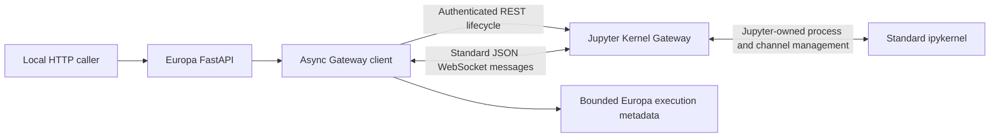
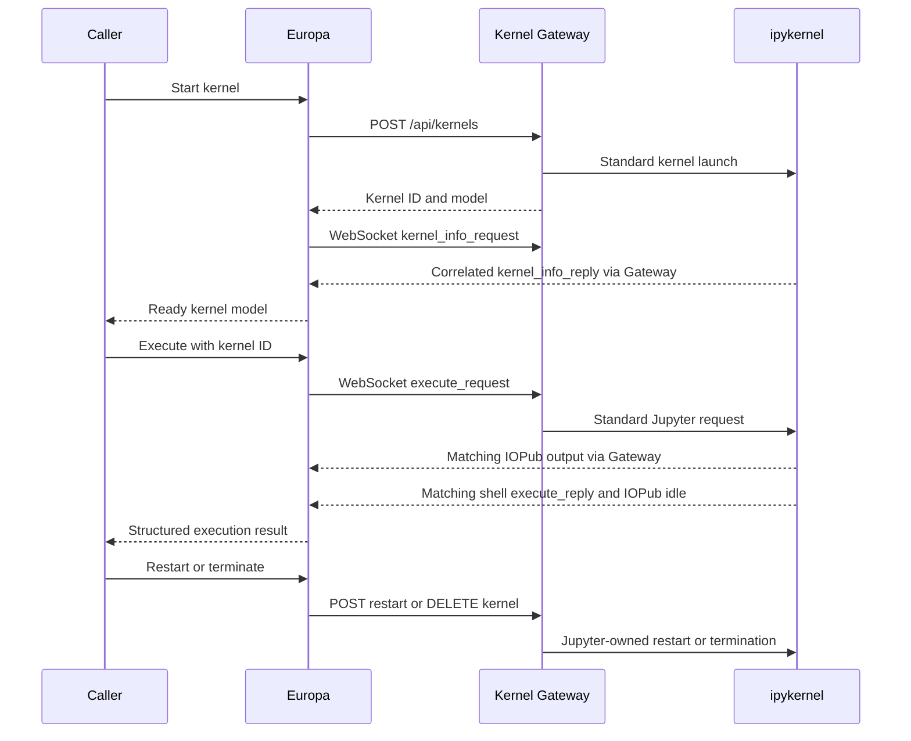

# Phase 2, Steps 1B and 1C: migration review

Completed on October 13, 2026 on branch `migration/jupyter-kernel-gateway`.
Original implementation is preserved at `c35de54ebdb282799c58239230f7e09e4c7f6680`.
This milestone stops at the Gateway migration and local integration tests.

## Result

Europa creates a standard ipykernel through Kernel Gateway, executes Python over
its official WebSocket channels, reuses interpreter state, interrupts execution,
restarts with state reset, and deletes kernels through the official REST API.
FastAPI remains the application boundary. No application subprocess manager,
Jupyter KernelManager, ZeroMQ reader, cleanup lock, monitor thread, or custom
Kernel/KernelWrapper remains.

The user's updated instructions authorized local development tests instead of
requiring Docker. Real tests used the repository `.venv`, authenticated Gateway
bound to 127.0.0.1, disposable working/home/config directories, and trusted bounded
code. This provides no hostile-workload isolation.

## Files changed

Added:

- `api/src/kernel/gateway_client.py`: async aiohttp REST/WebSocket adapter.
- `gateway/jupyter_kernel_gateway_config.py`: canonical local Gateway config.
- `requirements.in`, `requirements.lock`: direct pins and hashed universal lock.
- `pyproject.toml`: pytest configuration and integration marker.
- `tests/conftest.py`: opt-in local subprocess fixture, timings, teardown verification.
- `tests/test_gateway_integration.py`: real Gateway/ipykernel integration coverage.
- `tests/test_gateway_protocol.py`: network-free protocol regression coverage.
- `docs/phase2-review.md`: this report.

Modified:

- `api/src/main.py`: factory, lifespan-owned Gateway client, startup health, error mapping.
- `api/src/internal/router.py`: explicit kernel-ID API backed by official interfaces.
- `api/src/internal/models.py`: bounded nonblank code model.
- `api/src/internal/middleware.py`: omit query strings from request logs.
- `api/src/kernel/execution_tracker.py`: bounded terminal metadata only.
- `README.md`: setup, contracts, architecture, tests, and compatibility boundaries.
- `Dockerfile`, `.dockerignore`: optional pinned development image, non-root user,
  explicit application entry point, narrow source copying, environment exclusions.
- `.gitignore`: virtual environment, caches, and local test artifacts.

Removed:

- `api/src/internal/kernel_wrapper.py`
- `api/src/kernel/kernel_manage.py`
- `api/src/kernel/code_executor.py`
- `api/src/kernel/output_buffer.py`
- `api/src/kernel/health_monitor.py`
- `api/src/kernel/background_tasks.py`
- `api/src/kernel/package_installer.py`
- `api/src/tests/kernel_tester.py`

`test-results/integration.xml` and `test-results/gateway-timings.json` are actual
local validation artifacts, deliberately ignored by Git. `.venv` is also ignored.

## Architecture and request flow





REST routes are `/api/kernels`, `/api/kernels/{id}`,
`/api/kernels/{id}/interrupt`, and `/api/kernels/{id}/restart`.
The channel route is `/api/kernels/{id}/channels`.
Europa uses one WebSocket per operation, so HTTP requests do not compete for a
shared receive queue. Parent IDs and channel/message types are checked. Completion
requires both shell reply and IOPub idle. There is no custom queue or scheduling.
An application busy guard rejects overlapping execution/restart/shutdown with 409;
interrupt remains available. Timeout/cancellation/failure requests Gateway DELETE.

## Versions and configuration

Validated environment: macOS arm64, CPython 3.13.0; 103 installed packages.
The universal lock includes platform markers; only macOS was runtime-tested.

| Dependency | Version |
|---|---|
| Jupyter Kernel Gateway | 3.0.1 |
| ipykernel | 6.30.1 |
| Jupyter Server library | 2.17.0 |
| Jupyter Client library | 8.6.3 |
| aiohttp | 3.12.15 |
| FastAPI / Starlette | 0.116.1 / 0.47.3 |
| Uvicorn | 0.35.0 |
| PyZMQ / Tornado | 27.2.0 / 6.5.10 |
| pytest / pytest-asyncio | 8.4.1 / 1.1.0 |
| httpx / psutil | 0.28.1 / 7.0.0 |

Gateway: `kernel_gateway.jupyter_websocket`, loopback only, explicit token, port
fallback disabled, no pre-spawning, maximum four kernels, venv python3 kernelspec
only. The client sends credentials in headers, disables proxy inheritance, and
does not follow REST redirects. Kernel creation uses Gateway environment filtering;
the authentication token was verified absent from the kernel environment.

Client defaults: REST timeout 10 seconds, readiness timeout 30 seconds, execution
timeout 30 seconds, configurable up to 300 seconds, 4 MiB matching-message budget,
1,000,000 code-character limit, 50 terminal metadata records.

## Actual validation

Final command:

```sh
.venv/bin/python -m pytest --run-local-gateway -q -s --junitxml=test-results/integration.xml
```

**24 passed in 20.25 seconds; zero skipped, failed, or errored.**
This comprises 14 real integration tests and 10 pure protocol test cases.

Coverage includes Gateway readiness, REST and WebSocket authentication rejection,
kernel readiness and inspection, stdout, state reuse, sequential execution,
foreign-client message correlation, both completion signals, error recovery,
rich HTML/JSON/plain MIME bundles, REST interruption, restart/state reset and old
process disappearance, termination/model removal, timeout and cancellation
cleanup, conflicting operations, invalid kernelspec, FastAPI routes/lifespan, and
controlled Gateway process loss. Protocol tests cover both completion orders,
foreign idle/output, missing signals, wrong-channel replies, output limits, and
invalid authentication configuration.

Final startup/cleanup measurements:

- 14 separate Gateway processes: 0.7446–0.9049 seconds to authenticated readiness;
  mean 0.7834 seconds.
- 12 instrumented direct kernel creations: 0.1930–0.2324 seconds including readiness;
  mean 0.2034 seconds. FastAPI-created kernels were tested but not included in that
  instrumented sample.
- 14/14 Gateway subprocesses reaped; zero surviving captured descendants; zero
  forced process-group cleanups.
- A separate post-suite process scan found no Europa Gateway/ipykernel processes.

Additional checks: all 11 Python sources compile; application AST scan found no
subprocess, threading, Jupyter Client, or ZeroMQ imports; `git diff --check` passed;
`uv pip check --python .venv/bin/python` reported compatible installed dependencies.

Earlier attempts are not represented as successes: the sandboxed first invocation
had 13 setup errors because loopback binding was prohibited and launched no
Gateways. After execution permission, the initial integration run passed 13 tests
in 20.36 seconds. An expanded run passed 23 and failed one interruption test in
22.92 seconds; its REST execution-state polling was an unreliable start barrier.
The test now subscribes to standard `execute_input` before interrupting, with no
custom process/channel management added. The final run above passed all cases.

## Compatibility and remaining limits

- Jupyter Server is installed as Gateway's library dependency, not launched as a
  second service. Only Kernel Gateway is the canonical backend.
- Gateway does not provide notebook document editing/storage. Contents API,
  checkpoints, file-save hooks, and Server extensions need a separately evaluated
  Jupyter Server backend or document service. Kernel API overlap is not full
  feature interchangeability.
- Standard JSON channel messages are supported. Optional binary WebSocket
  subprotocols/buffer frames are not supported; they produce controlled errors.
- Execution returns buffered structured JSON rather than the prototype's streaming
  plain text. Kernel IDs are required. Restart waits for readiness; shutdown is 204.
- Package installation returns 501 and was not tested or run.
- Local execution is trusted-development-only, without container isolation,
  resource containment, or end-user authorization. The optional Docker image was
  not built or tested; its base tag is versioned but not digest-pinned.
- Ownership is in-memory per Europa instance. Multi-worker routing, durable
  reconciliation, notebook persistence, and user sessions are outside this milestone.
- If Gateway becomes unreachable or a kernel-creation response is lost, the client
  cannot prove remote termination or discover an unknown created ID. Cleanup
  failures retain known ownership and are logged for teardown retry; durable
  reconciliation remains future work. Gateway shutdown and the test fixture's
  process-group fallback contain these failures in the local test environment.
- The process fixture requires POSIX and checks captured process identities;
  Linux/container operation was not validated. This is not a dependency CVE audit.

## Old implementation versus replacement

| Concern | Prototype | Replacement |
|---|---|---|
| Process ownership | Custom Kernel and wrapper | Official Gateway/Jupyter managers |
| Lifecycle | Multiple restart paths, locks, daemon threads | Standard REST lifecycle operations |
| Channels | Shared custom ZeroMQ consumers | Standard per-operation WebSocket connection |
| Completion | Any idle message could end a stream | Matching parent ID, shell reply AND IOPub idle |
| Output | Plain text; buffers bypassed | Structured Jupyter messages and MIME data |
| Timeout/cancellation | Work continued; cancellation marked completed | Gateway termination requested; explicit metadata outcome |
| State | Universal worker singleton | Explicit Gateway kernel IDs; instance-owned handles |
| Tracking | Conflicting attributes and duplicate classes | Bounded application terminal metadata |
| Installation | Broken awaits and shell interpolation | Explicitly out of scope, 501 |
| Validation | Manual construction script | Real Gateway suite plus protocol regressions |

The HTTP/WebSocket adapter has no dependency on how Gateway is launched. A future
containerd/gVisor launch layer can provide the same URL/token interface without
rewriting this client; its runtime and security behavior will require separate
authorization and validation. No such orchestration was implemented here.

## Primary references

- [Official Gateway personality](https://jupyter-kernel-gateway.readthedocs.io/en/latest/websocket-mode.html)
- [Gateway 3.0.1 kernel handlers](https://github.com/jupyter-server/kernel_gateway/blob/v3.0.1/kernel_gateway/services/kernels/handlers.py)
- [Jupyter messaging specification](https://jupyter-client.readthedocs.io/en/stable/messaging.html)
- [Jupyter Server REST API](https://jupyter-server.readthedocs.io/en/stable/developers/rest-api.html)
- [WebSocket protocol compatibility](https://jupyter-server.readthedocs.io/en/stable/developers/websocket-protocols.html)
