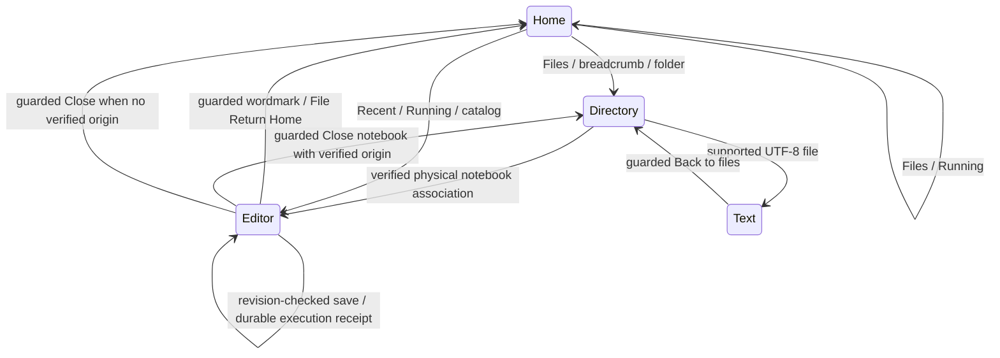

# Phase 3H D+E — integration and release validation

## Candidate and scope

2026-11-10. **D+E validation passed on the supported macOS/local-Gateway candidate.**
Linux/containerd certification and other limits below are explicitly excluded.

Starting branch: `feature/phase3h-workspace-navigation`.
Starting HEAD: `40386fb946a80e5252cbf4238d459860005812a9`.
The checkout contained the owner's uncommitted H1 and approved A–C work. It was
preserved, including the existing notebook editor and earlier screenshots/reports.
No reset, stash, owner-preview restart, storage migration, or infrastructure
configuration change was performed. No Europa preview listener was present at
the starting process inspection. All test services use loopback and disposable
real-path workspace, application, and notebook directories.

Scope includes navigation completion and validation of the integrated A–C
candidate. Kernel shutdown UI, application Quit/Logout, and Phase 4 remain outside
this milestone. Earlier checkpoint evidence remains in
[the dashboard report](phase3h-home-dashboard-validation.md) and
[the original report](phase3h-validation.md).

## Architecture and navigation

Browser history uses the same pending-operation and draft guards. Closing the
editor does not invoke runtime teardown. Physical documents remain canonical;
private metadata/receipts provide identity, association, and provenance without a
second document mirror. Existing catalog notebooks retain their storage model.
The read-only dashboard API contract and its six runtime states are documented
in the C section of the dashboard report; D+E do not add lifecycle endpoints.

## Corrections and reproductions

* A delayed document GET could replace an acknowledged newer save with an older
  revision. A deterministic controller test failed before the correction.
  Refresh acceptance now requires a strictly newer revision. Browser coverage
  holds an actual old response, saves code, releases it, and checks that the next
  Markdown move submits the acknowledged revision successfully.
* A receipt-history request begun before execution submission could arrive after
  acceptance and replace the newly accepted receipt with an empty history.
  A deterministic controller test reproduced the lost pending guard. A local
  receipt version fences history snapshots crossing submission. Backend receipt
  authority, CAS, execution admission, and execution requests are unchanged.
* A history event during notebook opening could leave the pending navigation
  path before the open completed. The existing navigation lock now also covers
  the non-notebook popstate branch. A focused navigation unit test covers it.
* Enlarged dashboard content exposed table overflow and compressed toolbar
  labels. Responsive rules now follow available dashboard container width;
  narrow toolbar/header groups wrap and table scrolling stays within its surface.
  Desktop composition, Files/Running hierarchy, and editor layout are preserved.
* Recovered application-message retry could be clicked before the canonical
  conversation arrived after reload, producing a misleading context error.
  Retry stays disabled until canonical scope is verified. A deferred-response
  unit test covers readiness; the original context and membership checks remain.

Initial full Chrome reproduction: **34 passed, 6 failed, 1 skipped**. Six failures
were outdated UI expectations: collapsed roadmap details, old absence of editor
Home links, old File-menu ordering, old title alignment, and two former Home /
Recent-region selectors. Tests now exercise the approved controls and explicitly
open collapsed roadmap details. Assertions about saved state and guards remain.
The original readiness and Markdown-move scenarios passed that reproduction;
this does not prove a historical root cause. The controlled races above provide
separate reproducible defects and regression evidence.

The expanded D run initially passed six of nine journeys. Its three failures
were test synchronization/expectation problems: interacting before document/API
readiness; comparing recent timestamps after deliberately reopening (which
correctly changes recency); and removing an intercepted route before its response
completed. A later conflict-review assertion incorrectly expected autosave to
resume; the contract intentionally keeps it paused after explicit draft review.
The tests synchronize readiness, inspect persisted recents before reopening,
await route completion, and verify disk acknowledgement while preserving pause.

The first combined 55-test run finished **42 passed, 12 failed, 1 skipped**.
It exposed a further removed catalog-navbar selector and accumulated local
runtime resource interference. A macOS `sample` of the owned API at 98% CPU
showed the event loop spending most samples in psutil process ancestry queries.
The local provider scans ancestry every 50 ms per live runtime. Earlier tests
left runtimes alive for the entire suite, making later requests take several
seconds and triggering multiple five-second DOM assertions. This is distinct
from notebook loss or failed persistence.

`web/browserFixtures.ts` now reaps disposable test runtimes through the existing
notebook-scoped runtime API after each test. It requires the combined suite's
explicit disposable root and matching loopback base URL, and excludes VM/preview
runs. It retains all catalog records/documents/history, including the growing
catalog interference scenario. Tests verify kernel survival before teardown;
an additional journey maintains two distinct live kernels across navigation.
No production shutdown feature or provider change is introduced. Local provider
scaling remains a documented limitation. Location, conversation-load, and text
save assertions also synchronize their actual response before checking rendered
state; they do not extend global timeouts or retry actions.

## Changed-file inventory

The release includes the pre-existing approved A–C changes, not only D+E fixes:

| Area | Files |
| --- | --- |
| Backend integration | `api/src/main.py`, `application/store.py`, `notebooks/router.py`, `workspace/{__init__,browser,mutation,router,notebooks,dashboard}.py` |
| Frontend navigation and dashboard | `Navigation`, `Pages`, `main`, `Home`, `PhysicalWorkspace`, `WorkspaceBrowse`, `TextFileEditor`, `Dashboard`, `useDashboardData` components and relevant tests; navigation/dashboard CSS and existing scoped style additions |
| D+E production corrections | `useNotebook.ts`, `Navigation.tsx`, `Workspace.tsx`, `PhysicalWorkspace.tsx`, `dashboard.css` and focused controller/navigation/workspace tests |
| Backend coverage | `tests/test_application.py`, `test_workspace_browser.py`, `test_workspace_notebooks.py`, `test_dashboard.py` |
| Browser coverage | Existing `web/browser/*.spec.ts`, unified `playwright.config.ts`, `browserFixtures.ts`, `browserSessionNavigation.ts`, A/B/C suite directories/configurations, new `browser-acceptance/{journeys,reliability,restart,visual}.spec.ts` |
| Review harness | `dashboard-preview.html`, `src/dashboard-preview.tsx`; remains outside production entry |
| Documentation | README, notebook persistence contract, Phase 3H design/brief/reports, original and new screenshot directories |

No containerd bridge, CNI, firewall, provider lifecycle, Gateway protocol, MIME
renderer, or resource admission implementation is changed by D+E.

## Validation evidence

Raw development logs and failure traces are retained locally under
`/private/tmp/europa-de-cotzsaqb`; they are disposable test evidence, not owner data
or repository artifacts. Starting screenshot files were copied before testing;
new captures use separate directories. No retries or global timeout increases
were used to hide failures.

The second combined run was **52 passed, 4 failed, 1 skipped** (3.1 min).
Remaining test assumptions concerned focus before dialog dismissal completed,
an ambiguous Europa link selector, assuming Idle immediately after HTTP kernel
creation, and retaining the title of an inaccessible document. Idle evidence now
follows actual execution; inaccessible recents correctly use the existing generic
unavailable entry. No runtime status is relabeled for tests.

The first final attempt was **53 passed, 3 failed, 1 skipped** (6.0 min). All three
failures exposed the same Running pagination synchronization problem: checking an
enabled button before the next page effect ran allowed the test to advance past
its target or click a row replaced by an outstanding response. The shared
`browserSessionNavigation.ts` helper now synchronizes each cursor's actual HTTP
response and its rendered title list before advancing. This includes the large
accumulated catalog and does not change production pagination or timeouts.

The first complete opt-in backend run was **330 passed, 1 failed, 79 skipped**.
The failure was an obsolete integration-test POST to create a notebook
conversation. The server correctly returned 409 because notebooks use the
canonical endpoint. The test now GETs that endpoint twice, verifies stable
identity, and retains all restart/source/output/comment/roadmap assertions.
Focused reproduction after repair: **1 passed**, exit 0, 4.21 s.

## Browser journeys and runtime evidence

The acceptance suite uses actual disk files, FastAPI, the production bundle,
authenticated local Gateway processes, and Python execution. Only delay/failure
injection scenarios intercept responses; they retain actual underlying documents
and committed mutations. The A composition harness remains explicitly separate.

* Physical project, standalone physical, and private-catalog journeys edit and
  execute Python, persist output and a conversation message, return Home, reopen
  through Running, and close to the verified source. Saved document equality,
  revision, conversation identity, runtime ID/generation, and the original
  execution kernel's continued existence are checked through backend evidence.
  Operational handles are used only by test infrastructure, never dashboard rows.
* A two-notebook journey executes both, retains distinct original kernels, and
  verifies Idle observations while navigating the shared Running dashboard.
* Draft cancellation, browser Back/Forward, physical/direct opens, delayed recent
  persistence, explicit saves, autosave, reload recovery, external modification,
  missing files, and explicit conflict review are covered across the original
  and new suites. An invalid route receives 404; returning to `/` restores Files.
* Execution success, traceback/error, interrupt, pending receipt refusal, transport
  loss/reconnect, lost application/creation acknowledgement, and uncertain
  receipt retention have actual browser/backend coverage. The timeout scenario
  asserts exactly one execution submission after Home/reopen. A lost creation
  acknowledgement replays exactly the same operation ID and notebook identity.
* Separate owned-backend restart journeys preserve private and physical notebook
  output, association, conversation, receipts, and server-persisted recent order.
  The physical journey also exercises backend loss/recovery while browsing.
  Recency is compared before reopening; a deliberate reopen updates its timestamp.

Backend dashboard tests cover Starting, Busy, Idle, Stopped, Unknown, and Needs
attention, generation and ownership races, isolated observation failures,
unresolved receipts/registry operations, bounded pagination/concurrency, and no
provisioning. Busy/Idle/Stopped browser captures use real kernels. Unknown uses
actual rows with deliberate transport failure. Starting/Needs attention include
controlled backend evidence; this report does not claim ARM64 observation proof.
Freshness expiry and finite refresh budgets use deterministic frontend clocks;
they are not certified by screenshots alone.

## Visual and usability review

This was a scripted heuristic evaluation, not a study with recruited people.
The beginner creates an actual project and notebook, runs Python, and returns
Home. Returning-user journeys use Recent, Running, and Close to source. Multiple
notebook journeys use nested paths, filtering, history, and paginated sessions.

Earlier H1 [Home](screenshots/phase3h/h1/home-desktop.png) and the approved A
[Files](screenshots/phase3h/dashboard-a/files-desktop.png) /
[Running](screenshots/phase3h/dashboard-a/running-desktop.png) captures are
preserved. Final Files has the approved 1170px centered workspace, compact 62px
identity header, 33px menu, Files/Running tabs, breadcrumb, right-hand menus, and
aligned table. It replaces the tall H1 recent/project/private-notebook sections.
Integration adds real metadata and paginated observations without adding cards
or competing primary views. Compact locale dates avoid unnecessary row wrapping.

The original two Jupyter attachments remain unavailable in the checkout/session.
Comparison is to the owner-approved A baseline and the documented classic Jupyter
structure, not a fabricated pixel comparison or a copied Jupyter brand.

| Requested capture | Real capture under `docs/screenshots/phase3h/final/` |
| --- | --- |
| Home / Files root | [Root](screenshots/phase3h/final/ui/01-home-files.png) |
| Physical project | [Project](screenshots/phase3h/final/workspace/real-project-directory.png) |
| Nested directory | [Nested](screenshots/phase3h/final/ui/05-nested-directory.png) |
| Recent dropdown | [Recent](screenshots/phase3h/final/sessions/recent-real.png) |
| New dropdown | [New](screenshots/phase3h/final/ui/02-new-menu.png) |
| Multiple selection | [Selection](screenshots/phase3h/final/ui/06-selection.png) |
| Empty directory | [Empty](screenshots/phase3h/final/ui/03-empty-directory.png) |
| Loading directory | [Loading](screenshots/phase3h/final/ui/10-loading-directory.png) |
| Workspace error | [Error](screenshots/phase3h/final/ui/11-workspace-error.png) |
| Idle kernel | [Idle](screenshots/phase3h/final/sessions/running-idle-real.png) |
| Busy kernel | [Busy](screenshots/phase3h/final/sessions/running-busy-real.png) |
| Observation unavailable | [Unknown](screenshots/phase3h/final/sessions/running-failed-refresh.png) |
| No sessions, empty actual catalog | [Empty Running](screenshots/phase3h/final/acceptance/empty-running-real.png) |
| Notebook from directory | [Editor](screenshots/phase3h/final/acceptance/project-editor.png) |
| Returned Home | [Home after execution](screenshots/phase3h/final/workspace/returned-home.png) |
| Text editor | [Text](screenshots/phase3h/final/ui/09-text-editor.png) |
| Application menu | [Help](screenshots/phase3h/final/ui/08-help-menu.png) |
| Mobile Files | [Files](screenshots/phase3h/final/workspace/real-project-mobile.png) |
| Mobile Running | [Running](screenshots/phase3h/final/sessions/running-mobile-real.png) |
| Mobile long filename | [Long filename](screenshots/phase3h/final/ui/responsive-390-100.png) |

The Files matrix exercises 1440×900, 1280×800, 768×1024, and 390×844 at 100%,
125%, 150%, and 200% CSS zoom/reflow. Captures at 100% and 200% are in `final/ui/`.
No global horizontal overflow is allowed; at extreme enlargement, the table can
scroll locally and controls wrap. Native Chrome zoom was separately probed and did not respond in headless Chrome;
CSS zoom is not represented as a real browser-zoom or device audit. No physical
touch-device audit was performed.

## Accessibility findings

Keyboard tests cover tab arrow keys and focus, file-row navigation, selection,
menu keyboard activation, Escape dismissal, focus restoration, and dialogs.
Semantic checks cover navigation landmarks, tab roles, table headers/captions,
named controls, textual runtime labels, status/error regions, and reduced-motion
media support. A dialog test now waits for actual dismissal before focusing the
composer, preserving the focus assertion rather than forcing a click.

Calculated text contrast for the stylesheet's light palette: body/white 14.13:1,
metadata/white 5.86:1, links/white 4.94:1, and error/white 7.09:1; dark metadata /
surface is 6.74:1. These checks do not constitute a complete automated WCAG audit.
No axe tooling was present, and no real screen reader was used. Color dots always
have readable state labels. Disabled shutdown remains visibly unavailable.

## Security and limitations

Workspace, notebook, and application tests preserve root confinement, symlink and
traversal rejection, private-storage exclusion, verified descriptor bindings,
stable physical mapping, canonical conversations, journal intent/exact replay,
collision rejection, notebook revision CAS, and receipt provenance. Existing MIME
and browser security regressions cover script/resource blocking and CSP. No text
endpoint is permitted to overwrite `.ipynb`; no move/delete/migration is added.
No runtime ownership, fencing, resource admission, or recovery rule is bypassed.

* Real Linux/containerd, ARM64 runc/runsc, CNI, warm-pool, and durable-provider
  integration remain infrastructure-dependent. The Lima VM was stopped; it was
  not started or reconfigured. Host local execution does not certify isolation.
* The local provider's synchronous ancestry observer can saturate the API with
  many simultaneously retained local runtimes. This was profiled and documented;
  runtime tracking was not rewritten in a navigation milestone. Tests isolate
  owned resources between cases and separately verify two live kernels.
* Running lists managed notebook records, including Stopped, in bounded ID order;
  it does not prioritize active sessions. Long-lived views intentionally stop
  automatic refresh and expire to Unknown until explicitly refreshed.
* Inaccessible Recent entries use a generic unavailable label; physical move /
  rebind and catalog migration remain unsupported. Unknown mutation outcomes
  retain their exact-replay controls rather than being discarded.
* Invalid arbitrary routes return the server's 404 response; a custom dashboard
  recovery page for every unknown URL is not introduced.
* Shutdown, Quit/Logout, agents, new LLM/MCP features, and infrastructure changes
  remain deferred.

## Final frozen-candidate test matrix

Toolchain: CPython 3.13.0 from `.venv`, Node 24.19.0, installed Chrome 156,
and Go 1.27.2 on macOS ARM64. Frontend commands use
`PATH=/Users/vjaiwantx/.nvm/versions/node/v24.19.0/bin:$PATH` from `web/`.
One heavy validation job ran at a time.

| Final command | Exit | Result |
| --- | --- | --- |
| `.venv/bin/python -m pytest --run-local-gateway -q -ra` | 0 | **331 passed, 79 skipped**, 44.38 s |
| `npm test -- --maxWorkers=1` | 0 | **94 passed**, 17 files, 9.18 s |
| `npm run build` | 0 | TypeScript and production Vite build passed |
| `PLAYWRIGHT_JSON_OUTPUT_FILE=/tmp/europa-de-cotzsaqb/browser-final.json npx playwright test --workers=1 --retries=0 --reporter=line,json` | 0 | **56 passed, 1 skipped, 0 failed, 0 flaky**, 147.34 s |
| `go test -count=1 -json ./...` from `containerd-bridge/` | 0 | **4 tests passed**, package passed, 0.497 s |
| `git diff --check` | 0 | No whitespace errors |

The backend run includes workspace browser/mutation/project-binding/physical
notebook/dashboard tests, notebook storage/execution, Gateway protocol, project /
conversation persistence, and real supported local-Gateway integration. The 79
skips require Linux/containerd infrastructure. They are not successes. The Chrome
skip is the explicit approved Lima/ARM64 runc probe (`EUROPA_VM_URL` absent).
Go's Linux-specific files are excluded by platform build tags, not certified here.

Chrome breakdown: original application **40 passed / 1 skipped**, physical
workspace **2 passed**, sessions **1 passed**, composition **2 passed**, and new
D+E acceptance **11 passed**. All are included in the default configuration;
focused A/B/C passes are no longer substituted for a complete run.

[Sanitized machine-readable UI evidence](phase3h-final-ui-evidence.json) records
all 16 reflow combinations, the native-zoom limitation, successful revision-4
Markdown move (HTTP 200 with revision 4), two distinct verified Idle kernels, and
physical restart identity/conversation/project/recent assertions. It contains no
runtime handles or credentials.

| Historical regression | Final disposition |
| --- | --- |
| API Connecting/readiness | Original checks pass; accumulated local-runtime interference profiled and fixture teardown added; no fake Connected state |
| Markdown move 409 | Original journey passes; delayed old GET race reproduced in unit test and real browser CAS regression now passes |
| Pending-execution navigation | Receipt-history ordering regression fixed; original G and physical B guards pass without suppressing warnings |
| Delayed recents | Existing POST-completion event and server-record synchronization pass in combined catalog |
| Asynchronous Close destination | Verified physical origin and catalog-origin checks pass, including deep link, immediate close, and history |
| Roadmap visibility | Explicit disclosure and current View controls tested; original planning/editing regressions pass |
| Large catalog fixture interference | Catalog retained across all tests, bounded pagination synchronized by actual responses/rendered rows; two live kernels tested separately |

The code/test input SHA-256 at final validation is
`1bc07f6945305a203124950343c97c22d12234e1a3d5fde2c5c79637a8629249`.
It hashes sorted paths and bytes under `api/`, `tests/`, `web/`, and
`containerd-bridge/`, excluding ignored build/test artifacts. It remained unchanged
through final validation and screenshot review. Documentation/captures are
separate from that input fingerprint.

The requested screenshot states were captured and visually inspected. The
200%-enlarged tabs, compact date rows, populated Recent menu, real Idle/Busy /
Unknown rows, real empty Running, editor, source return, and narrow Files were
reviewed after correction. No screenshot-only claim replaces backend evidence.
Earlier PNGs were byte-compared with their starting backup: **none changed or
missing**. All test listeners on 18000, 18100, 18101, and 18173 were gone after
validation; an unrelated pre-existing Python process was left untouched. No
owner preview was started or stopped.

The complete [changed-file inventory](phase3h-final-changed-files.txt) includes
the preserved A–C feature work and D+E corrections/evidence.

Implementation commit: `a6b2daab4f3662073f9edf411aea5bbcc1d31ce3` on
`feature/phase3h-workspace-navigation`. A documentation-only follow-up records
this identifier. The staged audit covered 332 files, including 264 PNG captures;
no notebook documents, SQLite files, registry state, credentials, symlinks,
submodules, build output, or unrelated work were staged. `AGENTS.md` was preserved.
No Phase 4 work begins.
