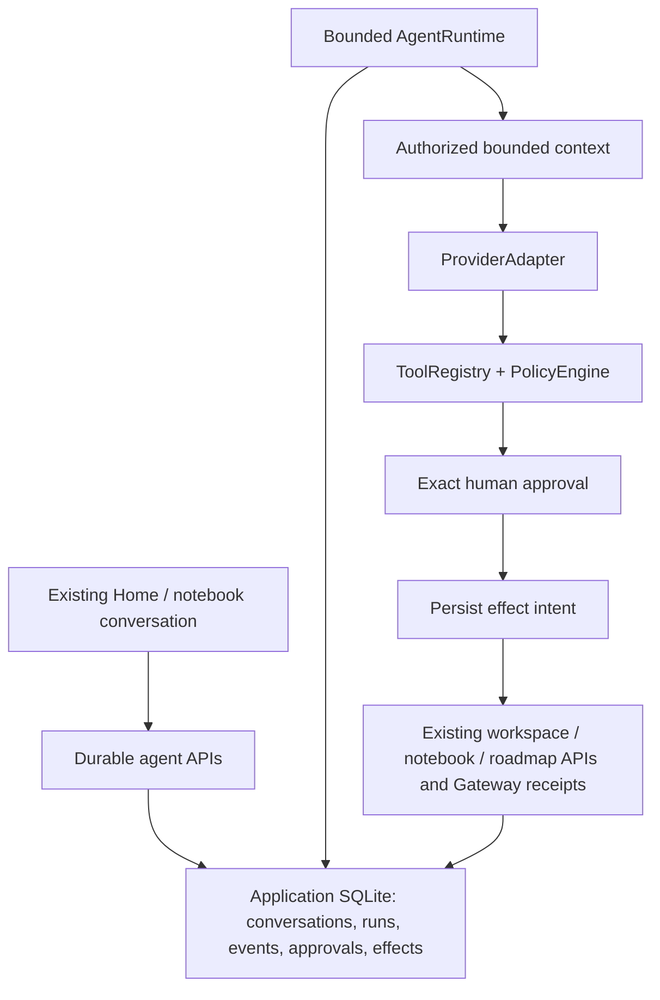

# Phase 4 architecture

The backend harness is the control plane. Models produce text and proposed typed
function calls; they never receive Python callables, permission grants, approval
endpoints, credentials, or direct filesystem/runtime access. The browser is a
client, not an executor. Scope is the existing single trusted loopback owner.

## Components

- AgentRuntime: one bounded worker, durable queue, fenced run lease, budget checks,
  provider calls, validated tool proposals, human approval waits and effect journal.
- ProviderAdapter: explicitly configured OpenAI-compatible Chat Completions or
  OpenRouter transport, deterministic labeled fake, and disabled default. No paid
  call occurs in routine tests. Non-streaming provider replies produce incremental
  public events; token streaming is not required for a resumable client.
- ContextManager: bounded snapshots of existing conversation/metadata/cells /
  outputs/roadmap with resource/revision provenance and explicit truncation. Resource
  contents and tool results are untrusted data, never system instructions.
- ToolRegistry and PolicyEngine: versioned Pydantic argument/result contracts,
  read/write/execute classifications, role permissions, resource grants, exact
  approval policy, timeouts and idempotency semantics. Models cannot select policy.
- ApprovalManager: immutable proposed arguments/digest/revision, target and expiry;
  decisions persist before work continues. One decision cannot authorize another call.
- AgentEventStore: append-only sequenced public events in the existing application
  SQLite database; paginated reconnect, no hidden reasoning/provider headers.
- RunRecovery: no stale worker commits, no automatic replay of in-flight effects.
  Known receipts can be observed; unknown execution outcomes require reconciliation.

Conversation messages remain existing application records. Workspace/project
conversation mappings extend that schema; notebook scope uses the canonical
conversation. Handoffs link histories and structured approved decisions rather than
copying histories. Supervised coding uses a bounded child run with an intersected
parent grant and an assigned notebook/task. Coordinator role cannot execute code.

The runc/containerd environment is not an adequate isolation boundary for arbitrary
untrusted autonomous code. Every coding mutation/execution remains supervised in
Europa's current trusted-user deployment. No shell/browser/network tool is offered.
