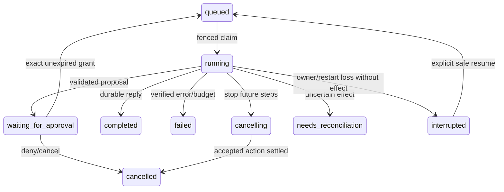

# Phase 4 harness design

## Durable contracts

Schema migrations use the existing application SQLite database, WAL/FULL sync,
notebook-before-application lock order, private owner boundary, and retained records.
Runs and effects are distinct. Run transitions:

A single fixed worker and bounded queue serve the local owner. Every worker commit
checks owner token, generation, lease expiry and current state. Side effects persist
intent before dispatch; tool-call IDs are unique within a run. Model calls are
bounded and not automatically retried. Provider failures are sanitized. Public
messages/events redact configured secrets and exclude provider reasoning fields.

Cancellation stops future model/tool steps, cancels pending approvals, and allows
an already accepted effect to settle. It does not claim to undo effects or shut
down a kernel. Receipt-scoped interrupt is a separate explicit owner action.
A browser disconnect is neither cancellation nor interrupt.

Budgets cover steps, requests, tools, wall time, conservative context bytes/tokens,
reported usage/output, concurrent active runs, nesting and repairs. Pending outcomes
and approvals remain in durable tables even if context cannot fit them; the run
fails conservatively instead of silently truncating unresolved authority.

## Provider contract

The adapter uses function tools and matching `tool_call_id` results from the
[official Chat Completions contract](https://developers.openai.com/api/reference/resources/chat/subresources/completions/methods/create).
The OpenRouter base URL and bearer authentication follow its
[Chat Completions reference](https://openrouter.ai/docs/api/api-reference/chat/create-a-chat-completion).
Arguments are parsed and validated locally; provider JSON/schema conformance is
not authorization. Model, endpoint and tool support are explicit configuration;
no latest-model assumption or implicit fallback. Requests are non-streaming and
bounded; public event polling provides incremental activity independently.

## Effect rules

- Read-only calls validate scope before reading and return bounded results.
- Resource creation reuses existing workspace operation IDs and verified bindings.
- Roadmaps reuse existing versioned application mutations, exact proposal approval
  and CAS; concurrent human edits remain authoritative.
- Cell changes use existing notebook mutation/CAS APIs, never raw `.ipynb` writes.
- Python uses NotebookService/Gateway/receipts, never host Python. Unknown outcomes
  stop; general exactly-once execution is not promised.
- Child grants cannot exceed parent grants; role checks further restrict usage.
  A proposed plan is not permission, and a model cannot issue an approval.

The implementation and validation reports refine these contracts with observed
limits and evidence at each checkpoint; unimplemented handlers are not registered.
