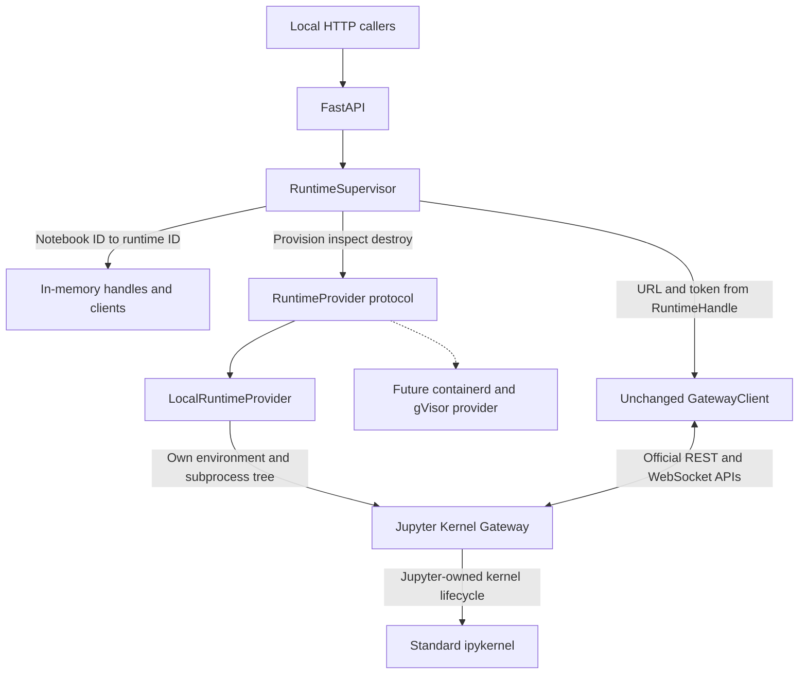

# Phase 2, Step 2A: runtime provider review

Completed October 13, 2026 on `feature/runtime-provider`, based on migration commit
`9dd0673`. The migration branch history is preserved. This milestone implements
local development runtime ownership only, not containerd, gVisor, MCP, persistence,
web UI, scheduling, idle eviction, or speculative warming.

## Inspection and refactor

Before this change, Gateway subprocess launch and teardown lived in
`tests/conftest.py`. FastAPI lifespan constructed a GatewayClient from a supplied
URL/token and closed owned kernels; it did not own a Gateway process. The client
already implemented official REST operations and standard WebSocket messages.

The functional fixture launch behavior is now in `LocalRuntimeProvider`; the
fixture uses that provider instead of a second launch implementation. GatewayClient
is unchanged. FastAPI lifespan owns a RuntimeSupervisor and receives its clients
from runtime handles, rather than constructing a hardcoded local endpoint.

## Runtime contracts

Shared, frozen data contracts are in `api/src/runtime/contracts.py`:

- `RuntimeSpec`: logical notebook ID, provider name, environment overrides,
  optional working directory, optional resource requests, startup deadline.
- `ResourceRequests`: requested CPU cores/memory bytes. Local requests are recorded
  only; `resource_limits_enforced` is false.
- `GatewayEndpoint`: URL/token; token is excluded from repr.
- `RuntimeHandle`: runtime ID, provider, notebook ID, endpoint, generation, lifecycle
  state, creation/start timestamps. No process handle or provider SDK objects.
- `RuntimeStatus`: handle, observed process liveness, readiness, failure information,
  and whether resource limits are enforced. Externally owned process liveness is unknown.

```python
class RuntimeProvider(Protocol):
    async def provision(self, spec: RuntimeSpec) -> RuntimeHandle: ...
    async def start(self, runtime_id: str) -> RuntimeHandle: ...
    async def inspect(self, runtime_id: str) -> RuntimeStatus: ...
    async def stop(self, runtime_id: str) -> None: ...
    async def destroy(self, runtime_id: str) -> None: ...
```

`provision` allocates a private environment and starts Gateway atomically, returning
after authenticated readiness. A separate allocation-only operation would be
redundant here. `stop` terminates processes but preserves environment and identity;
`start` resumes that stopped environment with a new endpoint/token and incremented
generation. It is idempotent for a running ready instance. Python interpreter state
does not survive Gateway stop/start. `destroy` stops and removes provider-owned
directories, retaining an in-memory destroyed tombstone for inspection. Repeated
stop/destroy calls, including unknown IDs, are no-ops; starting a destroyed ID fails.

An existing caller-owned working directory is never deleted. Default runtimes have
separate temporary working/home/config/runtime directories. Environment overrides
currently allow only LANG/LC_ALL; interpreter and package environment come from the
active Python virtual environment. Kernel Gateway configuration restricts kernels
to that environment's standard python3 kernelspec.

## Ownership and architecture



The local provider owns each Gateway subprocess, temporary environment, log file,
dedicated process group, captured descendant identities, per-runtime lifecycle
lock, and an async descendant-observation task. It does not send Jupyter messages
or implement kernel launch/restart algorithms. Gateway retains those duties.

Gateway launch uses asyncio subprocess execution, no shell, explicit loopback
binding, selected port, disabled port fallback, standard websocket personality,
and a generated authentication token. Fatal config loading is enabled via
`TRAITLETS_APPLICATION_RAISE_CONFIG_FILE_ERROR=1`; the tested trait is not a CLI
configurable setting. Startup is deadline-bound; port bind races may retry up to
three times after reaping the failed attempt. No existing service is stopped to
claim a port. There remains a bind/release race before Gateway binds its socket.

Readiness is an authenticated `/api/kernelspecs` response with python3 available,
combined with subprocess liveness. Kernel readiness remains GatewayClient's
correlated kernel_info exchange. Startup cancellation waits for any in-flight spawn
to obtain its process handle, then cleans up before propagating cancellation.

Stop requests graceful Gateway termination first, waits/reaps it with a deadline,
then force-cleans remaining owned processes if necessary. Jupyter launches kernels
in separate sessions; therefore the provider records descendant PID/create-time
identities while ancestry exists and uses those identities after Gateway death.
It never identifies workloads for termination by process name. No monitor threads
or ZeroMQ readers were introduced. Inspect after premature death cleans remaining
owned processes and returns FAILED rather than a healthy stale endpoint.

The supervisor owns notebook-to-runtime mappings and one transport client per
runtime. A per-notebook lock deduplicates concurrent provisioning without blocking
other notebooks. Shutdown rejects new provisioning and waits for in-flight notebook
locks before cleanup, so late launches cannot escape its registry. Cleanup failures
retain ownership for retry. Clients from different runtimes do not share kernel
sets or execution tracking. Direct out-of-band provider generation changes are
fenced rather than reused through an old client.

Managed notebooks currently use supervisor provision/destroy, not retained stop/start
through HTTP. Bare provider stop/start is tested and available to Python callers.
To replace a supervised dead/stopped runtime, destroy the notebook association and
provision again. No automatic recovery or replay is attempted.

## Application compatibility

Existing kernel methods, paths, kernel IDs, result bodies, error semantics, MIME
messages, interrupt/restart/shutdown behavior remain intact. Routes add optional
`notebook_id`, defaulting to `default`. New runtime endpoints provide explicit
provision/status/destroy. Status omits endpoint tokens. A logical notebook ID is
not an authentication or authorization boundary.

With `EUROPA_GATEWAY_URL` absent, FastAPI provisions a local default runtime. With
the previously supported external URL/token, it attaches an externally owned
runtime handle and closes its kernels/client without killing that Gateway service.
The original FastAPI integration test still exercises this compatibility mode.
Provider-managed lifespan cleanup is separately tested with two local runtimes.

HTTP execution continues returning buffered structured JSON. Step 1B did not expose
HTTP output streaming, and Step 2A does not introduce it. Standard WebSocket message
processing, correlation, and both completion signals are preserved unchanged.

## Tests and actual measurements

Final command:

```sh
.venv/bin/python -m pytest --run-local-gateway -q -s --junitxml=test-results/step2a.xml
```

**33 passed in 32.34 seconds; zero failures, errors, or skips.**
The original 24 cases were rerun, comprising 14 real Gateway integration cases and
10 protocol regression cases. Nine new real provider/supervisor cases cover:

- Provision, readiness, inspection, stop/start generation, destroy, repeated calls.
- Two notebook runtimes, separate endpoints and Python state, eight simultaneous
  same-notebook provisions, and A's termination leaving B usable.
- Fatal startup error with environment removal, startup timeout, cancellation.
- Abrupt Gateway death with kernel reclamation and stale-handle rejection.
- FastAPI lifespan cleanup of two managed runtimes.
- Shutdown during provisioning, plus retained ownership/retry after cleanup failure.

Trusted bounded code only was executed. No external workloads, package installations
inside kernels, destructive commands, or hostile exhaustion tests were run.

| Measurement | Samples | Observed range | Mean |
|---|---:|---:|---:|
| Gateway subprocess spawn return | 9 successful provider starts | 2.026–7.142 ms | 3.109 ms |
| Gateway authenticated readiness, including spawn | 9 successful provider starts | 794.022–873.989 ms | 808.947 ms |
| Gateway fixture provision/readiness | 14 regression fixtures | 736.2–989.2 ms | See raw records |
| Kernel creation/readiness | 12 instrumented regression creations | 198.0–365.8 ms | 232.792 ms |
| Two parallel kernel creations/readiness | 1 pair | 311.186 ms | 311.186 ms |
| Warm execution, including new WebSocket/handshake | 3 sequential calls | 7.058–9.925 ms | 8.033 ms |
| Runtime teardown, including failure paths | 12 provider teardowns | 2.799–402.686 ms | 115.014 ms |

These are small local macOS arm64 / CPython 3.13.0 samples, not performance guarantees.
Warm means interpreter reuse; the client still opens a fresh WebSocket per operation.
Fault-injected timing cases are not benchmarks. Failed starts are not included in
successful readiness samples. Gateway fixture data and new provider data are separate
sample sets, not every kernel startup in the test suite.

Runtime timing records show zero unreclaimed processes. One forced cleanup was
expected for the deliberate Gateway crash; all 14 normal regression teardowns
reported no forced cleanup and no live captured descendants. Raw local artifacts:
`test-results/step2a.xml`, `gateway-timings.json`, `runtime-timings.json` (Git-ignored).
A separate post-suite process scan found no remaining Europa Gateway/kernel PIDs.
All 16 Python sources compile, dependency compatibility checks pass, and
`git diff --check` passes. The shared Gateway client has no provider/process imports.

Earlier expanded runs exposed suppressed config errors and an incorrect assumption
that Gateway's process group contained kernels. Those failures were fixed before
the final run; they are not counted as successful validation. No dependency pins
or GatewayClient protocol implementation were changed.

## Files changed

Added: `api/src/runtime/__init__.py`, `contracts.py`, `local.py`, `supervisor.py`;
`tests/test_runtime_integration.py`; `docs/runtime-provider.md`.

Modified: `api/src/main.py`, `api/src/internal/router.py`, `tests/conftest.py`,
`tests/test_gateway_integration.py`, `README.md`.

Removed: none. Existing migration implementation/history and dependency locks remain.

## Limits and the future containerd/gVisor boundary

- Local processes are trusted development runtimes, not security sandboxes. CPU,
  memory, filesystem, and network restrictions are not enforced. Distinct notebooks
  have independent interpreters/default directories but share a host identity.
- POSIX only; runtime behavior was tested on macOS, not Linux or containerd. Process
  observation can miss a descendant created immediately before parent death; hostile
  processes can detach. This is not a replacement for cgroup/container ownership.
- State, notebook locks, diagnostic measurements, and destroyed tombstones are
  in memory. There is no service-crash reconciliation, distributed ownership,
  durable storage, automatic recovery, or metadata eviction.
- The supervisor treats the first spec for an existing notebook as authoritative;
  spec mutation requires explicit destruction/reprovisioning. User isolation/auth
  remains outside this trusted local milestone.
- A future containerd/gVisor provider must enforce resource requests, define images,
  filesystem mounts and networking, locate authenticated Gateway endpoints, own
  task/container teardown, and reconcile runtime death. POSIX process handles,
  PID polling, logs, and process groups stay behind the local provider boundary.
- Generation changes invalidate clients/kernel state; a future restart policy must
  refresh endpoint credentials and clients rather than reuse stale kernel IDs.
- Stop/start preserves a local environment but not interpreter state. Container
  restart and writable filesystem persistence must give an explicit equivalent
  contract rather than silently changing it.

Step 2A stops here. No Step 2B work was performed.

References: [Python async subprocess API](https://docs.python.org/3.13/library/asyncio-subprocess.html),
[Gateway websocket personality](https://jupyter-kernel-gateway.readthedocs.io/en/latest/websocket-mode.html).
